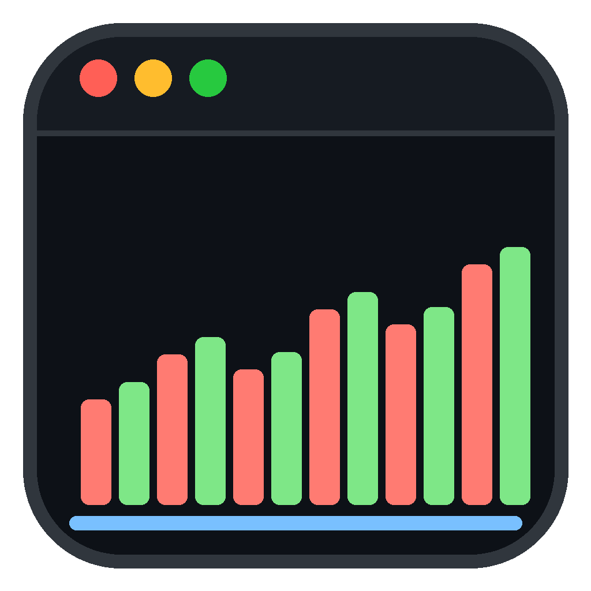
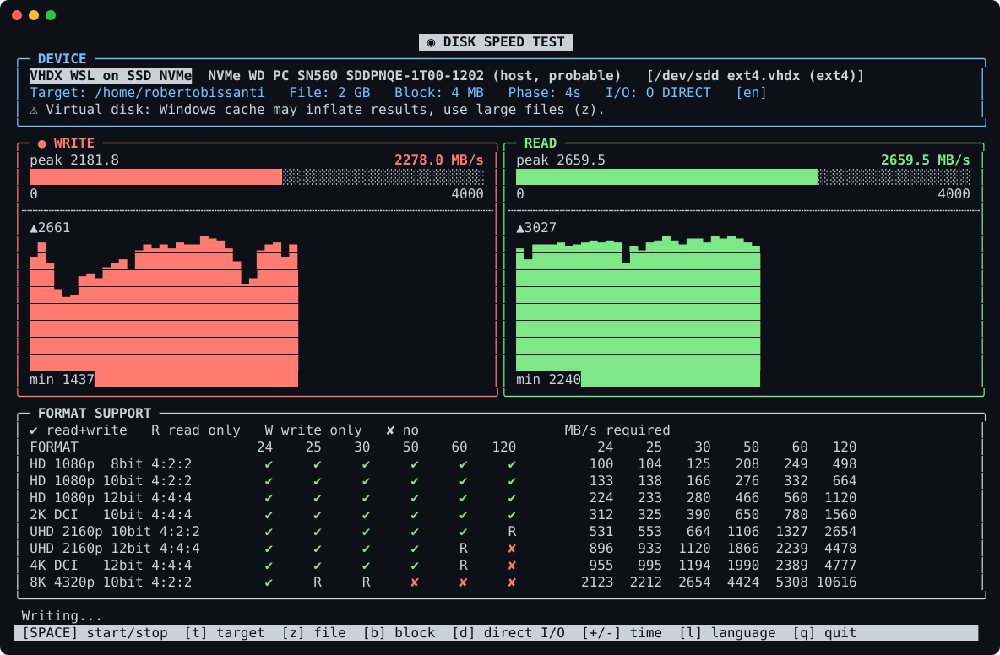

<p align="center">
  
</p>

<h1 align="center">speeddisk</h1>

<p align="center"><b>A cross-platform terminal (TUI) disk speed test for video workflows.</b></p>

<p align="center">
  <a href="https://github.com/robertobissanti/speeddisk/releases/latest"></a>
  <a href="https://github.com/robertobissanti/speeddisk/actions/workflows/release.yml"></a>
  <a href="LICENSE"></a>
  
  
  
  <a href="https://github.com/robertobissanti/speeddisk/releases"></a>
</p>

Runs on **Linux, Windows, macOS and WSL** as a single self-contained executable — no Python required.



## Features

- **Continuous write/read benchmark**: alternates sequential write and read phases on a temporary file.
- **Bypasses the OS cache** so it measures the disk, not RAM:
  `O_DIRECT` on Linux, `FILE_FLAG_NO_BUFFERING` on Windows, `F_NOCACHE` on macOS.
- **Device detection**: shows what you are actually testing — NVMe SSD, SATA SSD/HDD, USB drive, SD/eMMC, Apple SSD, virtual disk, RAM disk or network share — plus the model name.
- **WSL aware**: recognises the WSL virtual disk (`ext4.vhdx`) and Windows drives mounted through 9P (`/mnt/c`), identifies the underlying physical disk and warns you when results are skewed.
- **Live gauges and history charts** for write and read speed, with peak and minimum values.
- **Format support table**: which video formats (1080p up to 8K, 8–12 bit) and frame rates (24–120 fps) your disk can sustain.
- **Multilingual UI**: English, Italiano, Español, Français, Deutsch (auto-detected, switch with `l`).
- **Headless mode** for scripts and CI.
- Single file, standard library only (plus `windows-curses` on Windows).

## Download

Grab the binary for your platform from the [Releases](../../releases) page:

| Platform | File |
|---|---|
| Linux x86_64 | `speeddisk-linux-x86_64` |
| Linux ARM64 | `speeddisk-linux-arm64` |
| Windows x86_64 | `speeddisk-windows-x86_64.exe` |
| macOS Apple Silicon | `speeddisk-macos-arm64` |
| macOS Intel | `speeddisk-macos-x86_64` |

On Linux/macOS make it executable first:

```sh
chmod +x speeddisk-*
./speeddisk-linux-x86_64 /path/to/disk
```

On macOS, unsigned binaries are quarantined by Gatekeeper; clear the flag with:

```sh
xattr -d com.apple.quarantine speeddisk-macos-*
```

## Usage

```
speeddisk [target_dir] [--size GB] [--block MB] [--secs N] [--lang xx]
          [--no-direct] [--start] [--headless] [--cycles N]
```

| Option | Description |
|---|---|
| `target_dir` | Folder on the disk to test (default: current folder) |
| `--size` | Test file size: 1, 2, 5, 10 GB (default 1) |
| `--block` | I/O block size: 1, 4, 16, 64 MB (default 4) |
| `--secs` | Duration of each write/read phase in seconds (default 5) |
| `--no-direct` | Use cached I/O instead of direct I/O |
| `--start` | Start the test immediately |
| `--lang` | UI language: `en`, `it`, `es`, `fr`, `de` (default: system) |
| `--headless` | No TUI: run and print the results |
| `--cycles` | Write+read cycles in headless mode |

### Keys

| Key | Action |
|---|---|
| `SPACE` | Start / stop |
| `t` | Change target folder |
| `z` | Cycle test file size |
| `b` | Cycle block size |
| `d` | Toggle direct I/O |
| `+` / `-` | Phase duration |
| `l` | Change language |
| `q` | Quit |

The terminal must be at least **80×30**; charts grow with the window height.

### Headless example

```
> speeddisk.exe C:\ --headless --lang en
Device: SSD NVMe - NVMe WD PC SN560 SDDPNQE-1T00-1202 [Drive C:]
Target: C:\  direct I/O: True
WRITE best: 1714.5 MB/s   READ best: 2196.8 MB/s
```

## Notes on accuracy

- Use a test file larger than the drive's cache (`--size 5` or `10`) for sustained numbers.
- **WSL**: `~` lives in a virtual disk (`ext4.vhdx`), so the Windows host cache may inflate results. `/mnt/c` goes through the 9P protocol and is limited by the Linux↔Windows bridge, not the disk. For the real disk speed, run the Windows build natively.
- Network paths measure the network, and `tmpfs` measures RAM — speeddisk warns you in both cases.
- The temporary file `.speeddisk_test.tmp` is deleted when the test stops.

## Running from source

```sh
python3 speeddisk.py            # Linux / macOS / WSL
pip install windows-curses      # Windows only, once
python speeddisk.py             # Windows
```

## Building

```sh
./build.sh        # Linux / macOS -> dist/speeddisk
```

```powershell
.\build.ps1       # Windows -> dist\speeddisk.exe
```

Binaries for every platform are built automatically by GitHub Actions when a `v*` tag is pushed.

## License

BSD 3-Clause © 2026 Roberto Bissanti — see [LICENSE](LICENSE).
